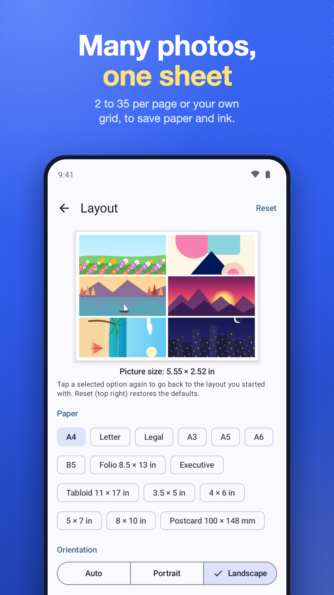
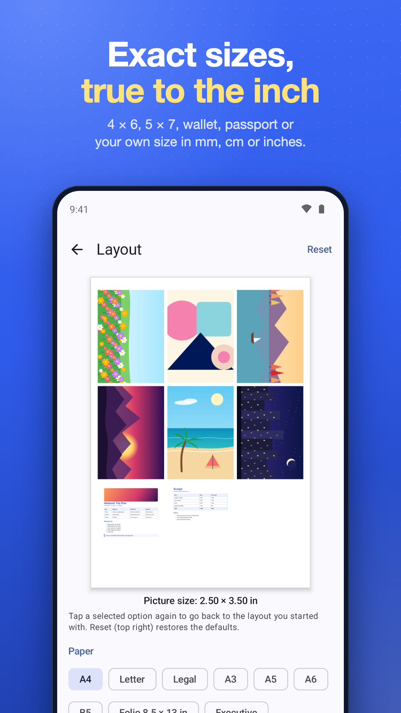
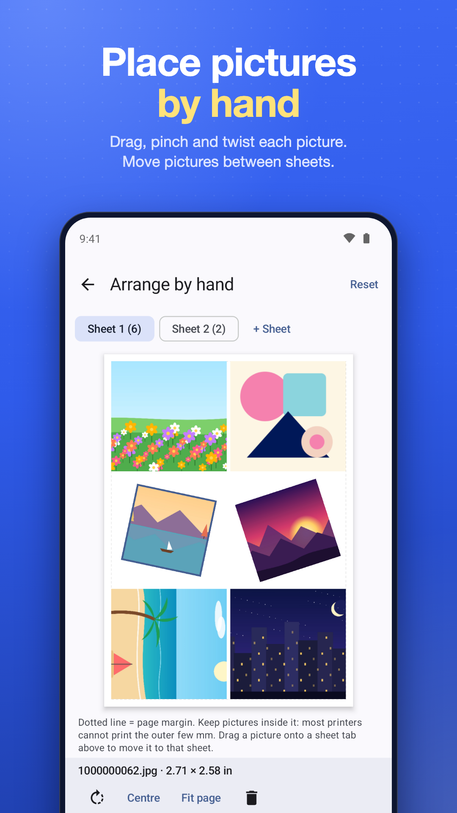
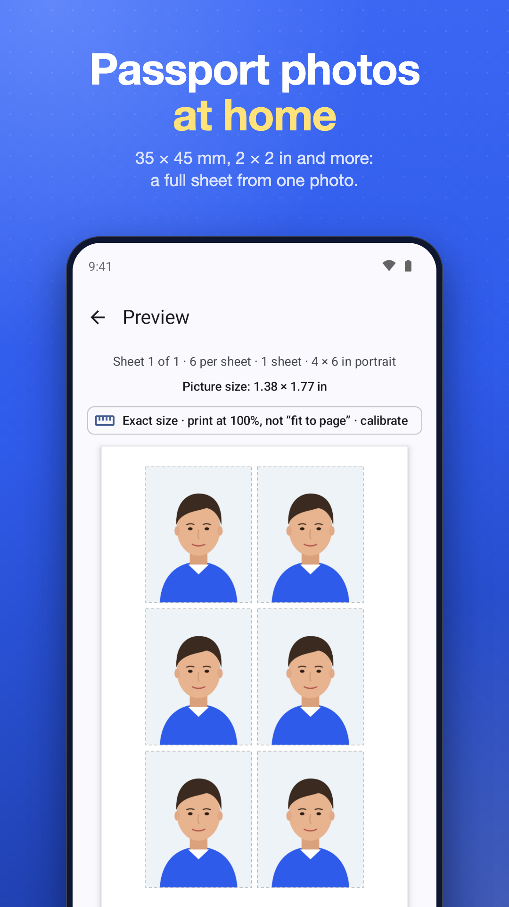
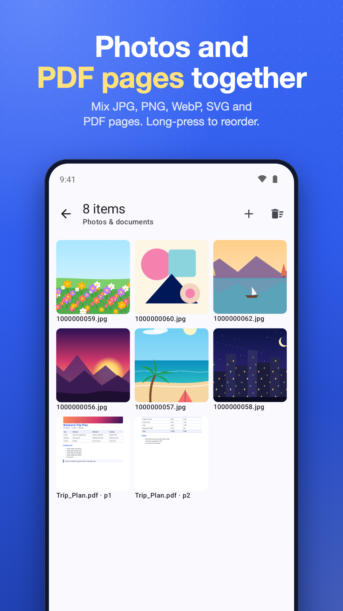
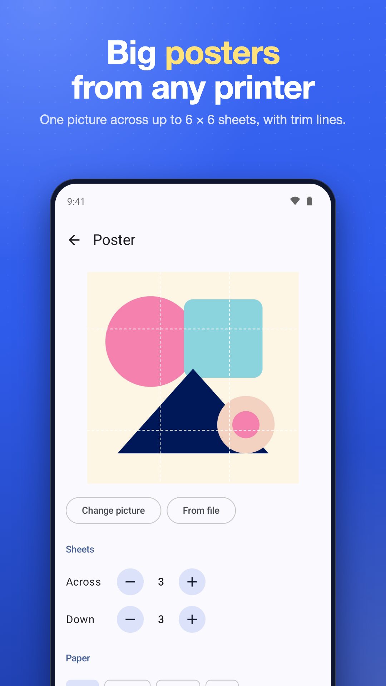
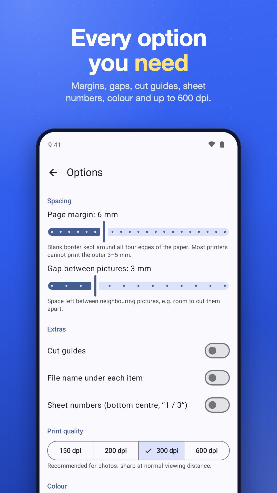
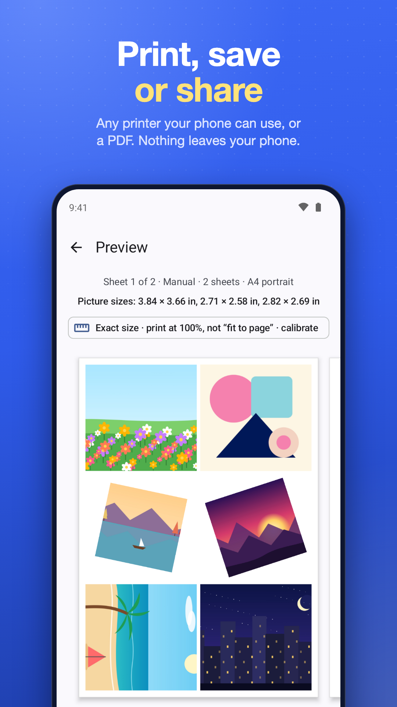

# MultiPrint

### Print many photos and PDF pages on one sheet, at the exact size you choose

4 × 6, 5 × 7, wallet and passport photos, contact sheets, posters, or pictures you place by hand. No account, no uploads.

&nbsp;
&nbsp;
&nbsp;

&nbsp;
&nbsp;
&nbsp;

---

## Many pictures, one sheet

- 2, 4, 6, 8, 9, 12 or 20 per page, a full-page print or a 35-picture contact sheet, or your own grid up to 8 × 8
- Mix photos, PDF pages, PNG, JPG, WebP and SVG images in one print job
- Every PDF page becomes its own item; long-press and drag to change the order

## Exact sizes

- 4 × 6, 5 × 7, 8 × 10, 3.5 × 5 in and wallet size, exact on any paper
- Type your own size in mm, cm or inches
- The real printed size in inches is shown under the preview
- Calibrate your printer once so sizes come out true to the millimetre

## Passport and visa photos

- 35 × 45 mm, 2 × 2 in (51 × 51 mm), 50 × 70 mm, 33 × 48 mm and 35 × 50 mm
- Position the face in the oval, and get a full sheet of copies with cut guides

## Place by hand

- Drag, pinch to resize and twist to rotate each picture
- Add copies, add more sheets and drag pictures from one sheet to another

## Paper saver and posters

- Paper saver trims blank edges and packs screenshots and scans tightly in columns
- Poster mode enlarges one picture across up to 6 × 6 sheets to tape together

## Full control

- 15 paper sizes, from A3 to A6, Letter, Legal and Tabloid to 4 × 6 photo paper and postcards
- Fit (whole picture) or Fill (no white edges) with a crop limit
- Page margin, gap between pictures, cut guides, file names and sheet numbers
- Colour, grayscale or ink-saver black & white; print quality from 150 to 600 dpi

## Print, save or share

Print to any printer your phone can use, save a PDF to Downloads, or share it to any app. You can also share photos and PDFs to MultiPrint from your gallery or file manager.

## Private by design

No account and no uploads: your photos and documents are laid out on your phone and never leave it. The app goes online only for ads (Google AdMob). Read the [privacy policy](PRIVACY.md).

## Feedback

Found a bug or a wrong size? [Open an issue](https://github.com/S0ul-Sh3ll/MultiPrint-Public/issues) or write to rishabhdahiya.work@gmail.com.

The app's source code is private. This repository holds its public pages: this README and the [privacy policy](PRIVACY.md).
